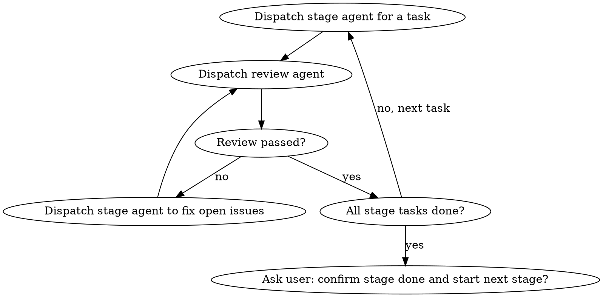

# mpm: Manage One Requirement's Development by Stage

## Overview

The directory containing `mpm.md` is the working directory for one requirement. Development runs through four stages; each stage has a directory and a main document (`README.md`):

| Stage | Directory | Outputs besides the main document |
|---|---|---|
| 01-Requirements | `01-requirements/` | `research-detail.md` `research-brief.md` `requirements-detail.md` `requirements-brief.md`; `research-data/` (external data); `research-log/` (daily research logs) |
| 02-Design | `02-design/` | Design documents, split as needed |
| 03-Development | `03-development/` | Code lives in the repositories and feat branches listed in `mpm.md` |
| 04-Self-Test | `04-self-test/` | Test cases and results |

Every stage directory has a `reviews/` folder for review records.

**You (the main session) only orchestrate.** Stage work goes to a stage agent, checking goes to a review agent, progress verification goes to a progress-check agent. The main session reads only `mpm.md`, plus the current stage's main document when needed; git, code, and other stages' documents are read by subagents. After dispatching a subagent, wait for its completion notification — do not poll with `sleep`.

Talk to the user in the user's language. Write project documents in the language already used in `mpm.md`.

Completion criteria for each stage: `stages.md`. Prompt templates for subagents: `agent-prompts.md`.

## Session Start Check

Triggered at session start (prompted by the SessionStart hook), or when the user says "continue" or asks about progress.

1. Read `mpm.md`.
2. Dispatch a **progress-check agent** (template in `agent-prompts.md`). Its job:
   - For every stage whose status is not "Not started", compare the task list in its main document with reality (for code repositories, look at commits and uncommitted changes on the feat branch);
   - Read "Findings To Discuss" in `01-requirements/README.md`, and any `research-log/` files newer than the last session;
   - Report the date the daily research job last ran.
3. Send the user one progress report, conclusion first, in this order:
   1. Current stage and how many tasks are done;
   2. Mismatches between records and reality ("none" if none);
   3. New research findings that may affect requirements;
   4. Suggested next step.

   End with: "Continue with: <next task>?"
4. Dispatch work only after the user confirms.

## Work Loop Within a Stage

- **Every change to a stage's outputs gets reviewed**, including fixes and change propagation. The review agent writes its result to `<stage dir>/reviews/<date>-<nn>.md` and adds an index line under "Reviews" in the main document.
- If the same issue still fails review after 3 fix rounds, stop and tell the user.
- **A stage is done only when the user confirms it.** After confirmation, set the stage to "Done (<date> confirmed by user)" in the `mpm.md` stage table, set the next stage to "In progress", and have the next stage's agent build its task list. Before the user confirms, the furthest you may set is "Awaiting confirmation".

## When the User Says "This Stage Is Done" or "Move to the Next Stage"

1. Dispatch a review agent with scope "whole stage". The result is written to `reviews/` as usual.
2. Review passed: relay the conclusion and ask "Confirm <stage> is done and start <next stage>?"
3. Review failed: relay the open issues and ask "Dispatch the stage agent to fix these open issues?" After the fix, go back to step 1.

## Propagating Requirement Changes

When the user confirms a requirement change (whether it came from the user or from a discussed research finding):

1. Add an entry to the Decision Log in `mpm.md`: date, what changed, why, who proposed it. Every stage in the stage table affected by this change whose status is "Done" becomes "In progress (requirement change <date>)"; once the change is handled and reviewed, ask the user to confirm those stages again.
2. Dispatch the 01 stage agent to update `requirements-detail.md` and `requirements-brief.md`, then review.
3. For each of 02, 03, 04 that has **already started**, in order: dispatch that stage's agent with a description of what changed in the requirements, have it update the stage outputs and log the change under "Upstream Changes" in its main document, then review. Stages that have not started need nothing — they read the latest requirements when they start.
4. Design changes propagate to 03 and 04 the same way.

## Rollback

When a stage agent or review agent reports "upstream problem", determine the cause first, then propose a rollback:

| Cause | Roll back to |
|---|---|
| Requirement missing, contradictory, not verifiable, or the business side wants to change it | 01-Requirements |
| Requirement is fine, but the design is infeasible, incomplete, or doesn't match the requirement | 02-Design |

Rollback needs user confirmation. After confirmation: record the cause and target in the Decision Log; set the target stage to "In progress" and any already-started downstream stages to "Rolled back"; once fixed, update downstream stages one by one following "Propagating Requirement Changes".

## Industry Research

- Daily research runs as a system scheduled job (launchd). Results go to `01-requirements/research-log/<date>.md`; entries that may affect requirements are appended to "Findings To Discuss" in `01-requirements/README.md`.
- **Research conclusions never modify requirement documents directly.** The flow: tell the user about the finding and discuss it; once the user explicitly decides to change a requirement, follow "Propagating Requirement Changes"; then mark the entry in "Findings To Discuss" as "Adopted" or "Rejected (reason)".
- In-session research (the user asks you to check some news) works the same way: write the conclusion to `research-log/` and update `research-detail.md` / `research-brief.md`; save useful raw material (release notes, data tables, benchmark results) to `research-data/`, with the source URL and fetch date at the top of each file.
- Install/uninstall the scheduled job: `bash ~/.claude/skills/mpm/scripts/research-job.sh install|uninstall|status <working dir>`.

## Session Handoff Log

Each time you report a milestone to the user, add an entry at the top of "Session Handoff Log" in `mpm.md`: `<date> what was done; next step; open questions`. Keep only the latest 10 entries; move older ones to `history.md`.

## Common Mistakes

| Mistake | Do this instead |
|---|---|
| Main session reads every stage's documents, then writes code or edits documents itself | Main session only orchestrates; stage work goes to stage agents |
| Stage agent finishes and you report "done" right away | Dispatch a review agent first; report after the review passes |
| Review conclusion only mentioned in chat, not written to a file | Write it to `reviews/` and index it in the main document |
| All tasks are checked, so you mark the stage "Done" | Only mark "Done" after the user confirms |
| Requirement document updated, then you go back to development | Propagate the change to every downstream stage that has started |
| Research says "this is better", so you edit the requirement document | Put it in "Findings To Discuss"; the user decides after discussion |
| Task details piling up in `mpm.md` | `mpm.md` holds one line per task for the current stage; details go in the stage's main document |
| User says "done", you dispatch a progress-check agent for a quick look and reply | Dispatch a review agent for a whole-stage review; write the result to `reviews/` |
| Main session runs `git status` or `ls -R` itself to verify | Hand verification to a subagent |
